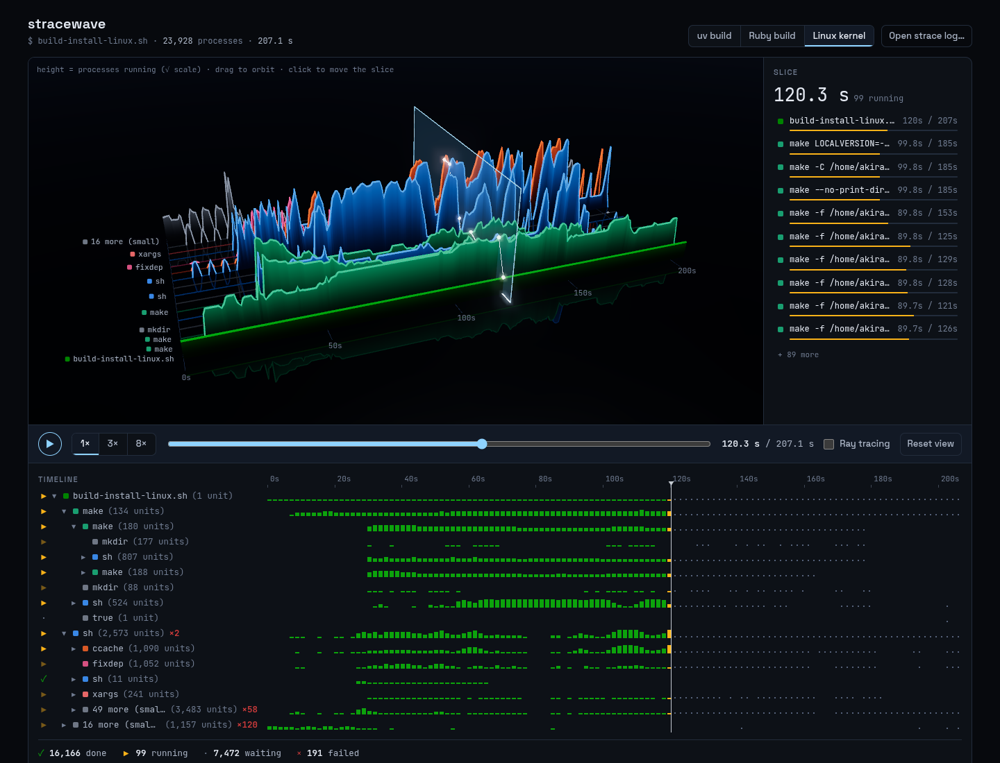

# stracewave

A 3D "wavetable" view of a build recorded with `strace`. Every row of the process tree becomes a ridge whose height is how many of its processes are running at that moment, and a time slice sweeps through the build.



This is a prototype.

## Try it

It is a static page with no build step. Serve this folder and open it:

```bash
python3 -m http.server 8000
# then open http://localhost:8000
```

three.js is loaded from jsDelivr, so the 3D view needs network access. The timeline works without it.

## Record your own build

```bash
strace \
    --trace=execve,execveat,exit,exit_group \
    --follow-forks \
    --string-limit=1000 \
    -ttt \
    --output=strace.log \
    --seccomp-bpf \
    <command to profile>
```

Then press **Open strace log…** or drop the file on the page. The log is parsed in your browser and is not uploaded anywhere.

## Reading the view

- **Ridges**: one per row of the process tree. Height is how many of that row's processes are running, on a square-root scale so a single long-running process stays visible next to a burst of a hundred.
- **Light sheet**: the time slice. Press play, drag the bars in the timeline, or click the 3D view to move it. The line on the sheet joins every row's height at that instant.
- **Slice panel**: the processes alive at the slice, longest-running first. Click one to copy its command.
- **Timeline**: green has finished, yellow is running now, dots have not started. The footer counts individual processes.
- **Ray tracing**: off by default. When on, the scene is path traced once it has been still for a moment and returns to the normal renderer as soon as anything moves. The first use compiles shaders, which took about 10 seconds on the machine this was developed on.

## How the process tree is built

- A process's parent is the process that received `SIGCHLD` for it. strace prints those signal lines regardless of the `--trace` filter, so no extra syscalls need tracing.
- Intermediate forks that never exec (subshells, for example) are skipped: each process attaches to its nearest ancestor that did exec.
- Processes with no known parent attach to the first process in the log. In the three example traces, 73 to 88 percent of processes link to a parent directly.
- Siblings that run the same program merge into one row. Siblings that account for under 0.4 percent of all process time share one "N more (small)" row, which opens like any other.

## Layout

| Path | What it is |
| --- | --- |
| `index.html` | The page and the import map for three.js |
| `src/parse.js` | strace log to compact trace |
| `src/app.js` | Process tree, timeline, slice panel and the 3D scene |
| `src/style.css` | Styles |
| `examples/*.json` | Three converted example traces |
| `tools/convert.mjs` | `node tools/convert.mjs strace.log > examples/name.json` |

## Known limits

- The tree is approximate when a parent is multi-threaded: `SIGCHLD` can land on a thread, and those children end up under the first process.
- `execveat` is not parsed.
- The whole log is read into memory, so multi-gigabyte logs will not load.
- Ray tracing needs WebGL2.

## Credits

The log format and the example traces come from [straceprof](https://github.com/akawashiro/straceprof) by Akira Kawata (MIT). See `NOTICE`.

At runtime the page loads [three.js](https://threejs.org/), [three-mesh-bvh](https://github.com/gkjohnson/three-mesh-bvh) and [three-gpu-pathtracer](https://github.com/gkjohnson/three-gpu-pathtracer) from a CDN; none of them is vendored here.

No license has been chosen yet for stracewave's own code.
